# Project workspaces

Workspaces for Brave and Chrome, built on tab groups. Each tab group is a project. Pick a project and its tabs open in the tab bar; the other groups fold into small labels.

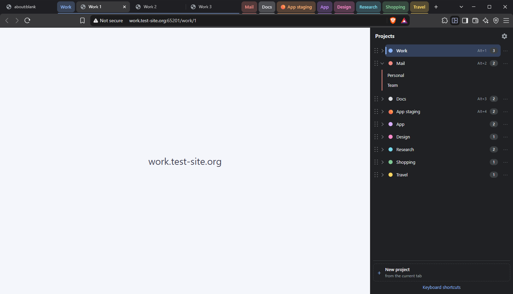

Private by design: no network requests, no analytics, no code from outside. See [PRIVACY.md](PRIVACY.md).

## A quick tour

**Before:** every tab group is open, and the tab bar is full of tiny tabs.

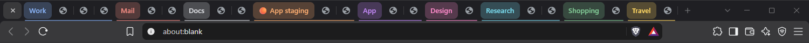

**After:** click **Mail** in the list (or press its key). Only Mail is open; the other projects wait as small labels. Click a label to switch.

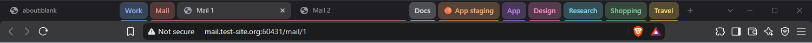

**Change a project** with **⋯**: colour, rename, move up or down, delete (deleting keeps every tab open). Drag the dots on the left to reorder; the tab bar follows. The list also fits a narrow panel.

<table>
  <tr>
    <td>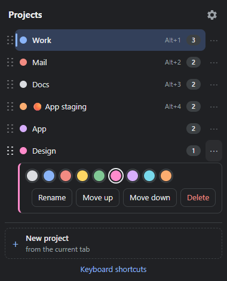</td>
    <td>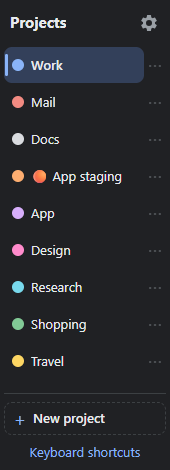</td>
  </tr>
</table>

**The project row** opens under the toolbar button, for quick switching. Press 1 to 9 to open a project.


**Settings:** each project has its addresses. A tab that opens one of them moves to the project. The dropdown lists your groups, and a wrong address gets a red outline with a hint.

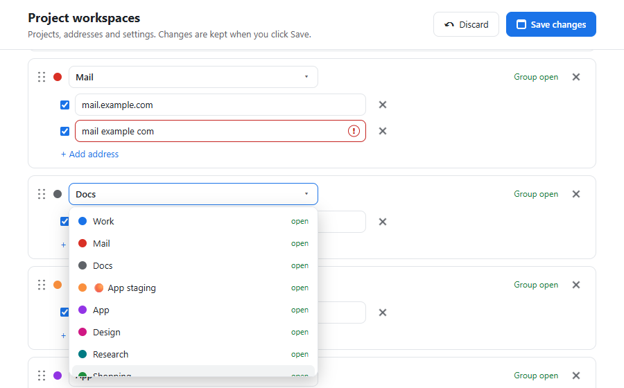

**Already open:** open a project address in a new tab while that site is open, and the new tab offers to take you to the tab you have.

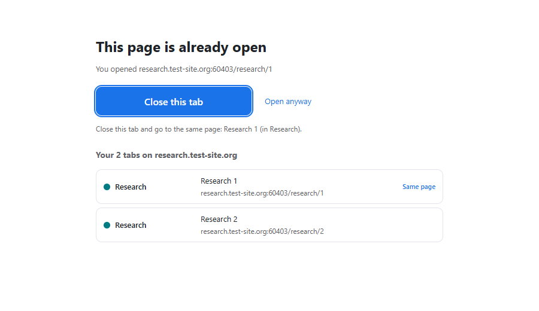

## Features

- **Project list** in the side panel, in the same order as the tab bar. Drag a project by its grip to reorder it; the tab bar follows, and dragging a group in the tab bar moves it in the list.
- **One project at a time.** Opening a project folds the other groups. Opening a folded group or one of its tabs from the tab bar does the same. You can turn this off.
- **Keys:** Alt+1 to Alt+4 open projects 1 to 4. Project 5 to 9, Next project, Previous project and Open the project row can be set on the shortcuts page.
- **Project row:** a row of project labels under the toolbar button, for quick switching. Press 1 to 9 to open a project.
- **Addresses per project:** a tab that opens `app.example.com`, `*.example.com` or `localhost:3000` moves to its project. Saving new addresses also sorts matching tabs that are already open. A tab you put in a group yourself is never moved.
- **"Already open" warning:** open a project address in a new tab while that site is already open, and the new tab offers to take you to the tab you have (or open it anyway).
- **Reopened windows** (Ctrl+Shift+T) and browser restarts get back the project that was open, on the tab you used last.
- **Staging projects:** a name that starts with 🟠 gets the orange group colour.
- **Hands off your tabs:** it never reloads tabs or puts them to sleep. It closes a tab only when you click "Close this tab" on the warning.
- **Works with Brave's vertical tabs:** each project becomes one row there, as narrow as you like.

## Install

### From a release

1. Download `project-workspaces-x.y.z.zip` from [Releases](../../releases) and unzip it.
2. Open `brave://extensions` (or `chrome://extensions`) and turn on **Developer mode**.
3. Click **Load unpacked** and choose the unzipped folder.
4. Click the puzzle icon in the toolbar and pin **Project workspaces**.

### From source

```bash
npm ci
npm run build
```

Then load the `dist` folder as above. After a change, run `npm run build` again and click the reload arrow on the extension.

## How to use it

1. Put the tabs of each project in a tab group and give it a name, or select tabs and click **New project** at the bottom of the list.
2. Click the extension's button. The list opens in the side panel.
3. Click a project, or press its key. Its tabs show; the other groups fold.
4. Click **⋯** next to a project to rename it, change its colour, move it, or delete it. Deleting only removes the group; every tab stays open.

## Settings

Click the gear at the top of the list.

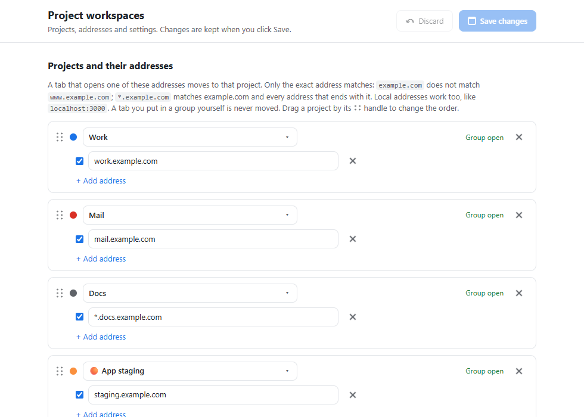

- **Projects and their addresses:** one card per project. Add as many addresses as you need. Without `*.`, only the exact address matches: `example.com` does not match `www.example.com`. With `*.`, the address and everything that ends with it match.
- **Already open:** turn the warning on or off. It only checks new tabs (typed addresses, bookmarks, links opened in a new tab, links from other apps). Links within one site and sign-in redirects are never warned.
- **Behaviour:** keep one project open, and choose what the toolbar button opens (the side panel or the project row).
- **Side panel: left or right:** the browser decides the side (see the next section).
- Changes are kept when you click **Save changes** in the bar at the top. The browser asks before you leave the page with unsaved changes.

## Put the list on the left

Brave shows the side panel together with its sidebar. Open `brave://settings/appearance`, go down to **Sidebar** and click **Show on the left**:

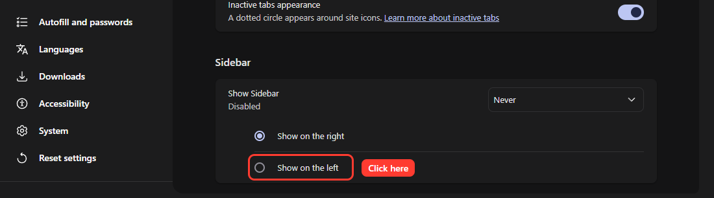

The project list is then on the left:

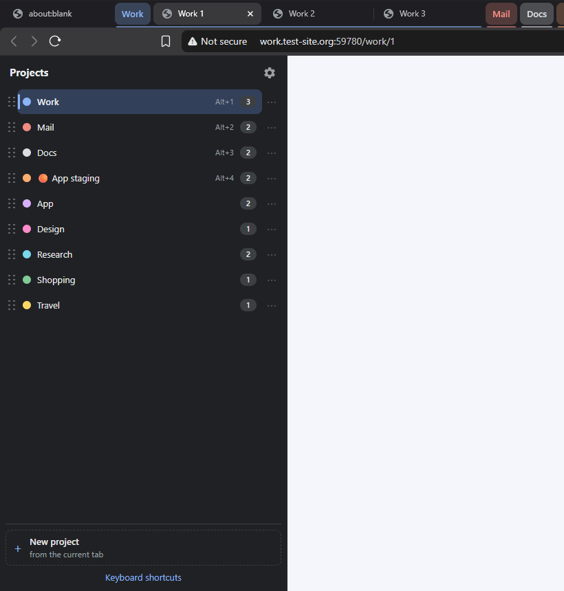

In Chrome: Settings > Appearance > Side panel.

## A narrow project list: Brave's vertical tabs

Brave does not let the side panel get narrower than about 400 px. For a narrow list, turn on Brave's vertical tabs: `brave://settings/appearance` > **Tabs** > **Use vertical tabs**. With this extension, each project is one row there, and only the open project shows its tabs. Drag the strip's edge to make it as narrow as you like (110 px works). Click a project row to open it; the others fold.

In the same place, **Show on the right** moves the strip to the right, and **Auto expand on hover when minimized** shrinks it to a thin bar that widens when you point at it.

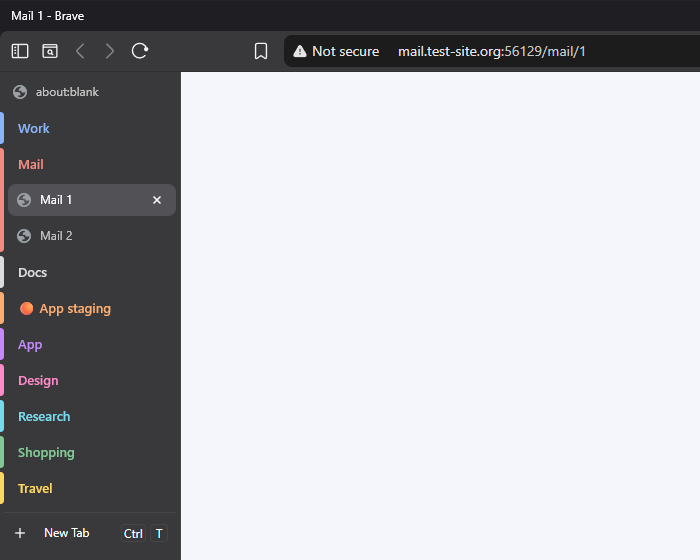

## Limits set by the browser

- Extensions cannot hide tabs, so the other projects stay in the tab bar as small folded labels.
- Extension panels sit on the left or the right, not at the top or the bottom. The project row covers the top.
- The browser decides how narrow the side panel can get (Brave: about 400 px). The list fits any width: names end with "..." and the extras hide. For a narrower list, use Brave's vertical tabs (see above).
- An extension may suggest only four keyboard shortcuts. Set the others yourself.
- If the browser's Memory Saver is on, the browser may put tabs you have not used for a while to sleep.

## Browser support

Brave and Chrome, version 116 or newer (the side panel API). Tested in Brave 1.99 and Chromium 156 on Windows.

## Development

```bash
npm ci
npm run typecheck
npm test
npx playwright install chromium
npm run smoke
```

- `npm test` runs the unit tests for the pure parts in `src/lib/`.
- `npm run smoke` loads `dist/` into Chromium with a throwaway profile and drives the real side panel, the settings page, the project row, the warning page, Ctrl+Shift+T and a browser restart. It builds first.
- `npm run smoke:brave` runs the same tests in an installed Brave (set `BRAVE_PATH` if it is not in the usual place). It never touches your own profile.
- GitHub Actions run the type check, the unit tests and the Chromium smoke tests on every push. Pushing a tag like `v0.2.0` builds the extension and attaches a zip to a new release.

How the parts fit together: [docs/how-it-works.md](docs/how-it-works.md). Contributing: [CONTRIBUTING.md](CONTRIBUTING.md). Changes: [CHANGELOG.md](CHANGELOG.md).

## License

[MIT](LICENSE)
