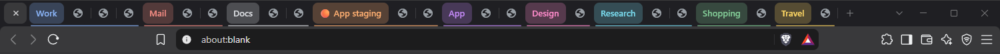
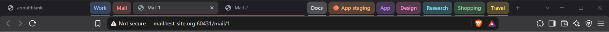
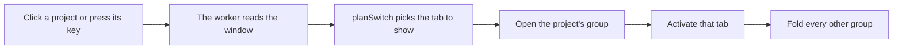
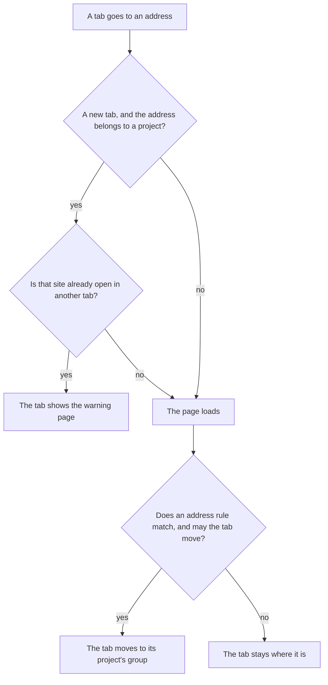
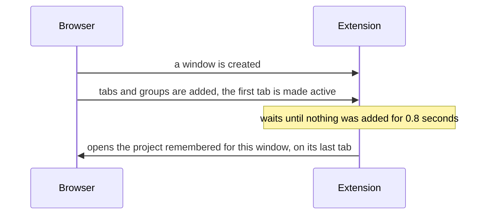

# How it works

Each tab group is a project. Choosing a project opens its group and folds the others:

## The parts

| File | Role |
|---|---|
| `src/background.ts` | The background worker. Every change to tabs, groups and saved data happens here, one at a time. |
| `src/panel.ts` | The project list (side panel), the project row (toolbar popup) and the narrow project window. It reads tabs and groups, and asks the worker for every change. |
| `src/projectWindow.ts` | The narrow project window keeping itself attached to its Brave window. |
| `src/options.ts` | The settings page. Everything is a draft until Save. |
| `src/already-open.ts` | The page a new tab shows when its site is already open. |
| `src/combo.ts` | The dropdown used on the settings page. |
| `src/lib/` | Pure helpers with unit tests: rules, switch plan, list order, group and tab moves, restore, the already-open check, project cards, tab tracking, tab lists and tab names, storage checks, the project window's layout. |

## Projects are tab groups

A project is a tab group. Group ids change every time the browser restarts, so nothing is saved by group id: projects are matched to groups by name (case and spaces do not matter). What is saved, in `chrome.storage.local`:

- `projects`: names and colours of the groups seen so far;
- `rules`: the addresses, each with a project name;
- `lastActive`: the tab last used in each project (its id and address; after a restart the address finds it again);
- `openProjects`: the project that was open in each window, keyed by the window's set of project names;
- `settings`;
- `tabNames`: the names given to tabs (see "Tab names" below);
- `expanded`: the projects whose tab list is open in the side panel;
- `projectWindowWidth`: the width new narrow project windows open at.

`chrome.storage.session` keeps bookkeeping that only matters while the browser runs (see "Rules" below, and the open narrow project windows with their Brave windows), and `tabNameLinks`: which open tab shows which name.

## Switching

`planSwitch` (in `src/lib/plan.ts`) decides how to show a project in a window: which tab to activate (the active tab if it is already in the project, else the tab used last there, else the first one), whether its group must open, and which other groups fold. The worker then acts: open the group, activate the tab, fold the others. Tabs are never closed, discarded or reloaded.

**Keep one project open:** when the user opens a folded group from the tab bar, or goes to a tab of another project, the worker folds the rest. Its own folds and opens are marked, so it does not react to them.

## Order

The list is always in tab bar order. Moving a project in the list calls `chrome.tabGroups.move`. The browser reads that index as the group's final position, counted without the group itself, and refuses an index inside another group; `groupMoveIndex` (in `src/lib/order.ts`) only returns group edges.

## Tab lists

The arrow next to a project shows its tabs under it, in tab bar order. Only the arrow opens or closes a list; switching projects never does. Clicking a tab switches to its project on that tab (`planSwitch` takes the tab). Dragging a tab calls `chrome.tabs.move` with an index inside the project's own range (`tabMoveIndex` in `src/lib/order.ts`), so the tab never leaves its group; if the browser takes it out anyway, the worker puts it back.

## Tab names

A name belongs to a tab, and the tab bar keeps the page title. Tab ids change after a restart, so each name keeps two addresses, both without the part after `?` or `#`: `home`, where the tab got its name, and `last`, where its tab was last. `linkTabNames` (in `src/lib/tabNames.ts`) matches names to tabs whenever a tab opens, closes or goes to another page:

1. A tab keeps its name while it browses the same site, and `last` follows it.
2. If it goes to a page that has a free name of its own (the other account of the same site), it shows that one.
3. A tab that leaves the site leaves its name behind.
4. A tab with no name takes a free name saved for its address, `home` first, then `last`. That brings names back after a restart, and when the page is opened again.

One name shows on one tab at a time. An empty name removes it.

## Rules

When a tab goes to a new site, the first matching rule names its project (an exact host wins over `*.` hosts; among `*.` hosts the longest wins). The tab moves to that project's group, which is made if the window has none.

A rule must never undo what the user did, so each tab is tracked:

- a tab opened from a link inside a group joins that group by itself, before its page loads: that is an automatic join, and a rule may move it on;
- any other group change by the user (a drag, "Add tab to group", "New tab in group", taking a tab out) makes the tab's place the user's choice, and rules leave it alone;
- tabs the browser restores count as placed by the user.

Saving new addresses also runs the rules over open tabs that are in no group.

What happens when a tab goes to an address:

## Reopened windows

When the browser reopens a window (Ctrl+Shift+T, or a restart), it adds the tabs and groups one by one and makes the first restored tab active. Reacting to that would open the wrong project. So a new window is left alone until no tab or group has been added for 0.8 seconds. Then the project remembered for that set of project names is opened again, on the tab used last.

## The already-open warning

The check runs for tabs that showed no web page yet: a new tab, a link opened in a new tab, a bookmark, a link from another app. If the address belongs to a project and another tab already shows that site (same host and port), the new tab is sent to the warning page. A link opened from the same site is never warned, and a tab going from one site to another (for example during a sign-in) is never checked. Everything the check needs is taken from the event itself, because a fast page (a local dev server) has loaded before any later look at the tab.

## The narrow project window

Brave's side panel cannot be narrower than 400 px, so the list can also live in a popup window of its own (`panel.html?view=window`). Each Brave window can have one, and it lists that window's projects. With that choice, the toolbar button has no popup and no panel, so its click reaches `chrome.action.onClicked`, and the worker opens that window's project window over it, or closes it when it is open. The worker keeps one record per project window: its id, its Brave window, and whether that window was maximized (it is maximized again when the list closes). A project window Brave brings back after a restart has lost its Brave window, because window ids change; it takes the nearest Brave window that has none (`nearestWindow`).

The page then keeps the pair together itself (`src/projectWindow.ts`), with the layout worked out by pure helpers in `src/lib/dock.ts`. The window the owner moved or resized leads, and the other follows:

- `followBrowser`: Brave moved or resized. The list goes beside it, at its height. When Brave's edge next to the list was dragged and the list sits at the screen edge, the list takes the new room instead. A list that would leave the screen stays at the edge and pushes Brave's edge.
- `followList`: the list moved or resized. Brave goes along, keeping its width, or its far edge when the edge between them was dragged.
- `dockLayout`: Brave maximized, or the list opened beside a maximized Brave. The list takes a strip at the screen edge on the sidebar's side, Brave the rest of the work area (`screen.availLeft` and the rest: the screen without the taskbar).

When Brave is on another screen, the list first steps onto it, inside Brave's edge, so the page learns that screen's work area, and then places both. The page's own moves fire `chrome.windows.onBoundsChanged` too: a window that is where the page put it is left alone.

During a drag, the window in the owner's hand is never moved: Windows would put it back under the pointer at the next step, or end the drag. So only the other window follows, and a move never "restores" a window that is not maximized or minimized (that would bring it to the front and take the focus). How each drag is heard:

- The list's edge: the page gets a `resize` event for every step of its own window, and moves Brave's edge in the same frame.
- Brave: `chrome.windows.onBoundsChanged` fires only now and then during a drag (often once, when the size stops changing). From that first event, or from the pointer leaving the list through the edge next to Brave (about to grab it), the page looks at Brave every 40 ms and moves the list with it. When Brave has stayed still for a second, the drag counts as over, and only then may Brave itself be moved: to keep the list on screen, or not narrower than it can be.

Every rectangle is worked out as what shows of a window. Windows gives each window an invisible border for resizing (7 px on the left, right and bottom at 100 %, none at the top), and windows are placed by their outer box, so two windows placed edge to edge show a gap of two borders. The page measures the border from inside its own window (`frameInset`: its outer width less the width its page gets, less the 1 px line that shows) and places both windows so their visible edges touch. It measures twice, a moment apart, and keeps the value only when both agree: mid-resize, the page is a step behind its window and the answer is wrong. It measures again when the screen's scale changes (the window moved to another screen).

Focus and minimizing follow `chrome.windows.onFocusChanged`: when one of the pair comes to the front from another app, the other is brought up behind it, and the first gets the focus back. When Brave is minimized, the list is too, and it comes back with Brave. A list the owner minimized alone stays down.

## Staying light

The extension runs all day next to every tab, so the busy paths do as little as possible.

The background worker:

- stops title, icon and loading-progress updates (most tab events) before doing any work;
- runs only the newest of a quick run of tab switches, and reads only the window's groups for it, not every tab;
- checks a new tab against the project addresses before it makes any browser call;
- batches saves for a second, and skips a save that would write the same data again.

The side panel:

- reads all tabs and groups only when the window's layout changes (a tab or group added, removed or moved);
- applies smaller news (a new title, another active tab, a group recoloured or folded, saved names) to what it already holds;
- keeps every row whose content did not change, so a new title redraws one row, at most every 0.4 seconds;
- draws nothing while it is hidden.

The narrow project window acts only on its own two windows: their moves, and focus coming to them from another app. It places a window only when that window is not already where it belongs, and it looks at Brave every 40 ms only while Brave may be being dragged.

## Testing

- `test/unit/`: the pure helpers, plus a scan of the source for anything that could reach the network.
- `test/smoke/`: the built extension in Chromium (and in Brave, if installed), each with a throwaway profile. Test pages come from a local server; the browser maps the test host names to it, so nothing leaves the computer. The real side panel is driven through `chrome.extension.getViews()`.
- `test/helper-ext/`: a test-only extension with the `sessions` permission, used to reopen a closed window the way Ctrl+Shift+T does.
